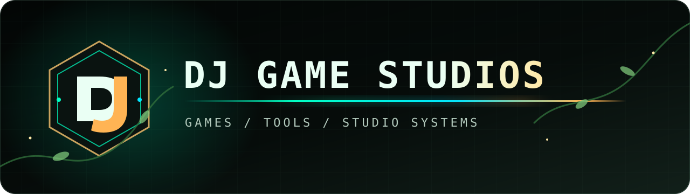

An independent game studio led by [DJ MSQRVVE](https://youtube.com/@djmsqrvve).

[Website](https://djmsqrvve.com) · [YouTube](https://youtube.com/@djmsqrvve) · [Twitch](https://twitch.tv/djmsqrvve)

## Helix

**Helix is our main universe:** a fantasy-first world centered on evolution, identity, spirit, and transformation. Its first public game is **Helix 2000**, a 2D browser MMORPG in public alpha at [helix2000.com](https://helix2000.com). A larger persistent world is the long-term goal and is in private development.

<!-- public-games:start: generated by brand/wggs/scripts/check_public_games.py --write; edit the website's game registry instead -->
## Our games

- **Helix 3D** — Our flagship 3D fantasy MMORPG, a persistent world in private development.
- **Helix 2000** — A browser MMORPG in public alpha with character classes, combat, quests, crafting, and social play. Play at [helix2000.com](https://helix2000.com).
- **DJ Engine / Helix Fracture** — Our own 2D engine and editor for story-driven games, with Helix Fracture as its first story. On hold while the studio focuses on Helix 3D and Helix 2000.
<!-- public-games:end -->

Genre experiments and alternate interpretations support the long-term direction; they do not replace it.

## Follow development

Development videos, demos, and behind-the-scenes work are published on [YouTube](https://youtube.com/@djmsqrvve) and [Twitch](https://twitch.tv/djmsqrvve). Studio updates and future public releases are collected at [djmsqrvve.com](https://djmsqrvve.com).

---

Games, tools, and the systems that make both possible.

